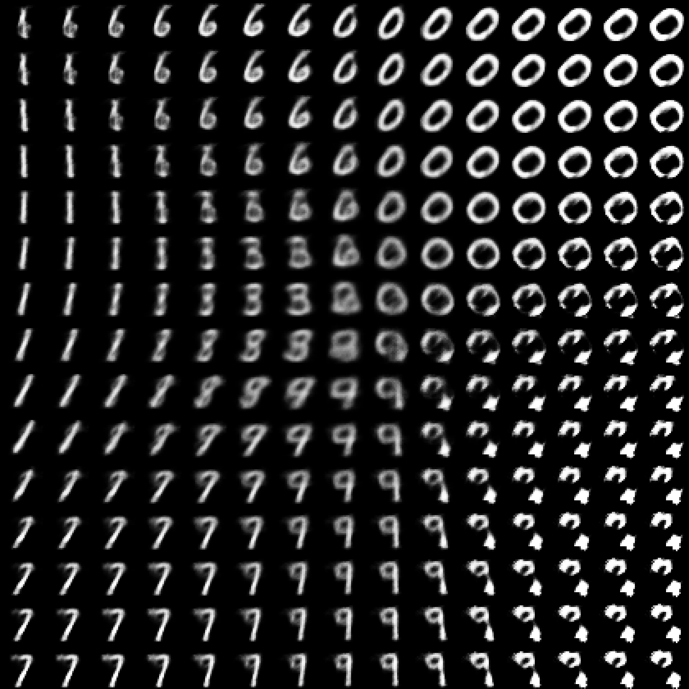
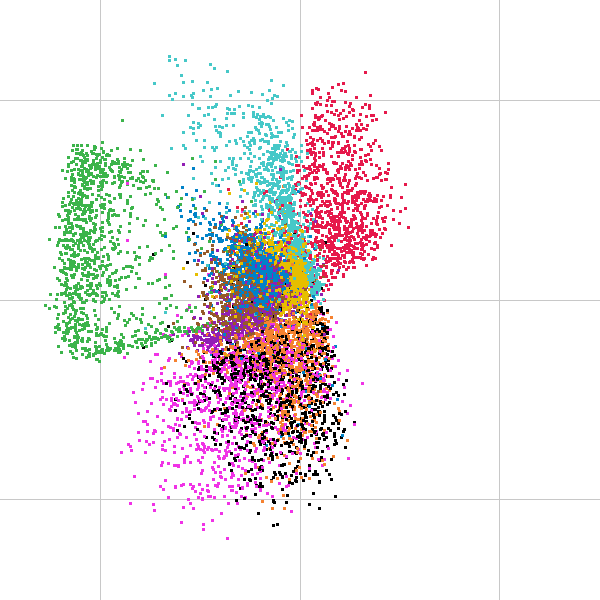
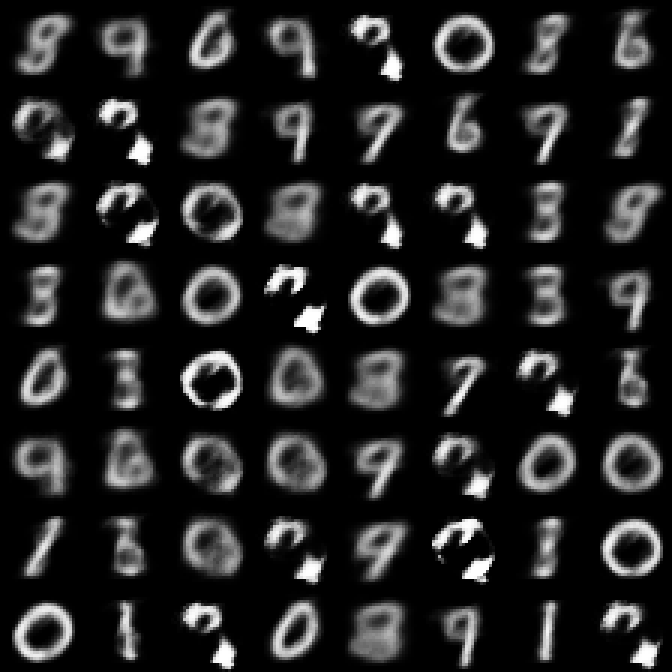
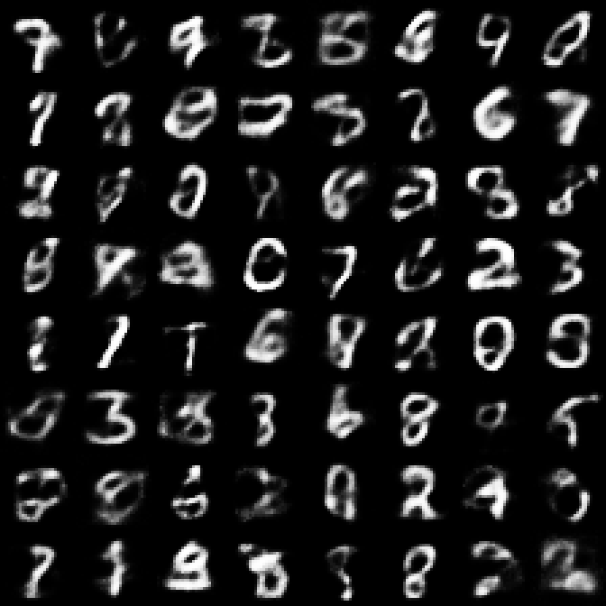

# VAE de la zero în C++

Un Variational Autoencoder care învață să genereze cifre scrise de mână (MNIST), scris în C++ simplu, fără nicio bibliotecă de învățare automată.

<p>
  
  
</p>

*Stânga: cifrele desenate de decoder într-o grilă de coduri din [-3, 3]². Dreapta: codurile celor 10 000 de imagini de test, colorate după cifra reală (etichetele n-au fost folosite la antrenare).*

## Ce conține

- **Autoencoder** și **VAE** (784 → 400 → d → 400 → 784), cu dimensiunea codului d configurabilă
- **Clasificator** propriu (97,5% acuratețe pe test), folosit pentru a evalua cifrele generate
- Hărți ale spațiului latent, cifre generate, KL pe fiecare dimensiune

## Rezultate

După 5 epoci, pe setul de test:

| Cod | Refacere | KL | Cost total | Încredere clasificator | Cifre distincte efective |
| --- | --- | --- | --- | --- | --- |
| d = 2 | 153,2 | 5,7 | 158,5 | 0,81 | 7,4 / 10 |
| d = 16 | 87,2 | 23,2 | 109,5 | 0,76 | 9,4 / 10 |

Codul mai mare explică mult mai bine datele și acoperă toate cifrele, dar o parte din eșantioane sunt amestecuri între cifre: un compromis între calitate și diversitate.

<p>
  
  
</p>

*Cifre generate din coduri aleatoare: d = 2 (stânga), d = 16 (dreapta).*

## Rulare

Necesită un compilator C++17 și CMake ≥ 3.16.

```bash
./scripts/download_mnist.sh   # descarcă MNIST în data/
./scripts/run_all.sh          # compilează, antrenează și evaluează totul
```

Imaginile ajung în `results/`, modelele antrenate în `models/`.

## Structură

```
src/        matrice, straturi, ReLU, costuri, Adam, modele, salvare
examples/   programele: explorarea datelor, antrenare, evaluare
scripts/    descărcarea datelor, rularea completă, imaginile pentru README
```